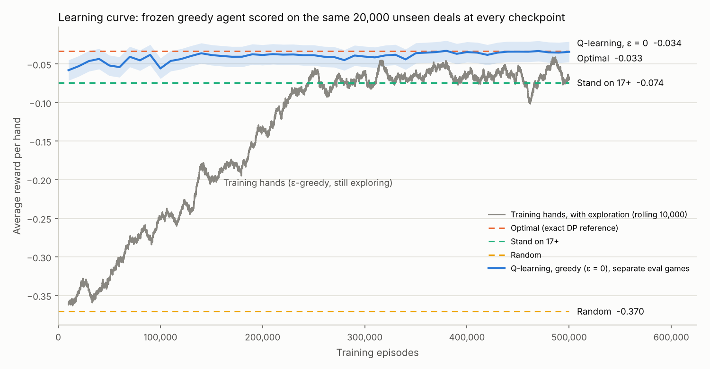
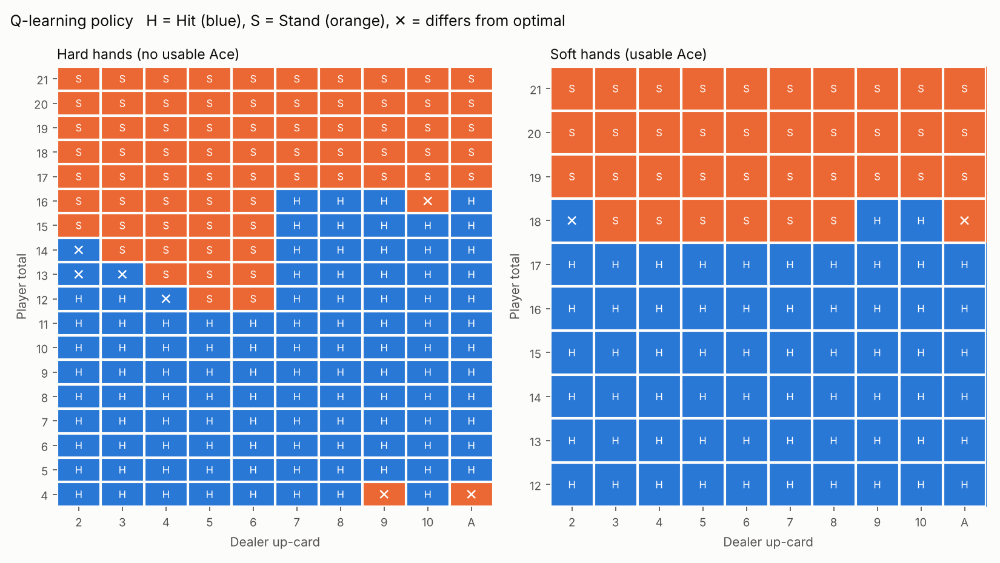

# CS 471 Final Project — Q-Learning for Blackjack Strategy

A tabular **Q-learning** agent learns when to **Hit** or **Stand** in a simplified game of Blackjack by playing simulated hands. After training, the frozen agent is evaluated with **no exploration** on **separate games** and compared against fixed strategies and the exact optimal policy.

## Results (checkpoint)

All four policies play the **same 100,000 unseen deals** (evaluation seed 2026; training seed 471). Rewards are +1 win, −1 loss, 0 push.

| Policy | Avg reward / hand | 95% CI | Win | Loss | Push |
|---|---:|---|---:|---:|---:|
| **Q-learning** (500k training hands, ε = 0 at test) | **−0.0481** | [−0.0540, −0.0421] | 43.2% | 48.0% | 8.8% |
| Optimal (exact dynamic-programming reference) | −0.0474 | [−0.0533, −0.0414] | 43.2% | 48.0% | 8.8% |
| Stand on 17+ (copies the dealer) | −0.0779 | [−0.0837, −0.0720] | 41.1% | 48.9% | 9.9% |
| Random (50/50) | −0.3637 | [−0.3694, −0.3581] | 29.8% | 66.1% | 4.1% |

* The learned policy is statistically the same as optimal and clearly beats both comparison strategies.
* It chooses the optimal action in **271 of 280** states. The 9 misses are near-ties (e.g. hard 16 vs 10, where the two actions differ by 0.0006) or states that almost never occur (hard 4 = a 2+2 deal).
* A negative average is expected: no Hit/Stand-only strategy beats the dealer under these rules.




## Repository layout

```
cs471-blackjack-qlearning/
├── blackjack_rl/              # all project code (importable package)
│   ├── env.py                 # Blackjack simulator; the rules are in the docstring
│   ├── agent.py               # Q-learning: update, ε-greedy, training loop (mirrors HW4 Parts VI–VII)
│   ├── baselines.py           # comparison strategies: random, stand-on-17
│   ├── optimal.py             # exact optimal Q* by dynamic programming (reference only)
│   ├── evaluate.py            # exploration-free evaluation on fixed, shared deals + 95% CI
│   ├── dataset.py             # Kaggle data: loading, dealer check, offline Q-learning
│   ├── experiment.py          # hyperparameters (CONFIG) and the experiment pipeline
│   └── plots.py               # figures
├── notebooks/
│   └── checkpoint_demo.ipynb  # the walkthrough, saved WITH outputs
├── scripts/
│   └── run_experiment.py      # reproduces every number and figure without Jupyter
├── tests/                     # 18 pytest correctness checks
├── data/
│   └── sample_hands.csv       # first 6,000 rows of the Kaggle dataset (tests use this)
├── results/                   # CSV tables + PNG figures written by run_experiment.py
├── requirements.txt
└── README.md
```

## Setup

Requires **Python 3.10+**.

```bash
git clone <your-repo-url>
cd cs471-blackjack-qlearning

python -m venv .venv
# macOS/Linux:
source .venv/bin/activate
# Windows (PowerShell):
.venv\Scripts\Activate.ps1

pip install -r requirements.txt
```

## How to run

Run every command from the repository root.

| Task | Command | Time |
|---|---|---|
| Run the correctness tests | `python -m pytest -v` | ~5 s |
| Reproduce all results and figures → `results/` | `python scripts/run_experiment.py` | ~10 s |
| Quick smoke run (50k episodes) → `results/quick/` | `python scripts/run_experiment.py --quick` | ~2 s |
| Open the walkthrough notebook | `jupyter notebook notebooks/checkpoint_demo.ipynb`, then *Kernel → Restart & Run All* | ~1 min |

Everything is seeded, so repeated runs on the same machine give the same numbers.

## Dataset (optional)

[900,000 Hands of BlackJack Results](https://www.kaggle.com/datasets/mojocolors/900000-hands-of-blackjack-results) (Kaggle, `mojocolors`). The training and evaluation results above **do not** depend on it; it is used for the simulator check and the offline-learning experiment in Part 6 of the notebook.

The notebook calls `dataset.load_hands("auto")`, which looks for the data in this order:

1. `data/blkjckhands.csv`, if you placed it there yourself.
2. A download through `kagglehub` (the same call as in Kaggle's sample code):
   ```python
   import kagglehub
   path = kagglehub.dataset_download("mojocolors/900000-hands-of-blackjack-results")
   ```
   If Kaggle asks for credentials, create an API token at kaggle.com → *Settings → API → Create New Token*. Then either save the downloaded `kaggle.json` to `~/.kaggle/kaggle.json` (Windows: `C:\Users\<you>\.kaggle\kaggle.json`) or set the `KAGGLE_USERNAME` and `KAGGLE_KEY` environment variables. **Never commit `kaggle.json`** (it is in `.gitignore`).
3. Otherwise, `data/sample_hands.csv` (6,000 rows, committed to the repo), so the notebook and tests always run.

To download manually instead, get the zip from the Kaggle page, unzip it, and put `blkjckhands.csv` in `data/`.

## Simulator rules (Required Revision #3)

| Rule | Choice |
|---|---|
| Deck | Infinite deck (each card drawn with replacement). 2–9 face value, 10/J/Q/K = 10, Ace = 11 unless that busts, then 1 |
| Naturals | Checked before the player acts. Player natural only = +1 (not 3:2); dealer natural only = −1; both = 0 |
| Player actions | Hit or Stand only (no double, split, insurance, or surrender) |
| Player bust | Immediate −1; dealer does not play |
| Dealer | Hits below 17; **stands on all 17s**, including soft 17 |
| Outcome | Higher total wins (+1/−1); tie = 0 |

**State:** (player total 4–21, dealer up-card A–10, usable Ace) → 280 decision states. **Actions:** Hit, Stand.

## Algorithm and hyperparameters

Q(s,a) ← Q(s,a) + α [ r + γ · maxₐ′ Q(s′,a′) − Q(s,a) ], with target = r at terminal steps.

| Parameter | Value |
|---|---|
| Training episodes | 500,000 |
| Learning rate α | 0.01 (constant) |
| Discount γ | 1.0 (only the final outcome matters) |
| Exploration ε | 1.0 → 0.05, linear over the first half of training, then held |
| Initial Q | 0 for every state-action pair |
| Seeds | training 471, checkpoint evaluation 1000, final evaluation 2026 |

All values live in `blackjack_rl/experiment.py` → `CONFIG`.

## Evaluation protocol (Required Revisions #1 and #2)

* **Comparison strategies:** random (lower bound), stand-on-17+ (human rule of thumb), and the exact optimal policy from dynamic programming (upper bound). The optimal policy is a reference only; the Q-learning agent never sees it.
* **No exploration at test time:** the trained Q-table is frozen into a greedy policy (ε = 0) and is never updated during evaluation (checked by a test).
* **Separate games:** evaluation deals come from their own seed, distinct from training. Every policy plays the same deals (common random numbers), so differences reflect decisions, not luck.
* **Metric:** average reward per hand with a 95% confidence interval (mean ± 1.96·σ/√n), plus win/loss/push rates. A learning curve evaluates a frozen copy of the agent every 10,000 training episodes on a fixed set of 20,000 deals.

## Correctness checks

`python -m pytest -v` runs 18 checks. The main ones:

| Check | Expected behavior |
|---|---|
| Q-update vs. hand calculation | 12 vs 4, Hit → 16: Q=−0.20, r=0, max Q′=−0.30, α=0.1, γ=1 → target −0.30, TD error −0.10, new Q −0.21 |
| Terminal update | Target is r only; the next-state value is ignored |
| Ace scoring | A+6 = soft 17, A+6+10 = hard 17, A+A = 12 |
| Dealer rule | Hits 16, stands on soft 17 |
| Simulator vs. exact math | Monte Carlo dealer bust rate within 0.5 points of the DP value |
| Reproducibility | Same seed → identical Q-table; evaluation never changes Q |
| Obvious actions | Stand on hard 20–21; hit hard 8–11 |
| Headline result | random < stand-17 < Q-learning, and Q-learning within 0.01 of optimal on unseen deals |
| Dataset parsing | Recorded hands become correct (s, a, r, s′) sequences; mis-scored hands dropped |

## Known limitations and findings

* **Rare states learn slowly.** With a constant α = 0.01, states like hard 4 (1 deal in 169) still have Q-values near 0 after training. A per-state learning rate α = 1/N(s,a) would fix this.
* **Near-ties are noisy.** For hard 16 vs 10, Q*(Hit) and Q*(Stand) differ by 0.0006, so the learned choice can go either way. This barely affects reward.
* **Dataset scoring error.** With the dealer showing an Ace or a low card, some recorded totals are wrong (e.g. A, A, 4, 6 recorded as 22 instead of 12). This inflates the dataset's bust rate with an Ace up (18.8% recorded vs. 16.7% exact). For up-cards 2–10, the recorded dealer matches our rule to within one percentage point. Mis-scored hands are excluded from offline learning.
* **Offline learning has coverage gaps.** The recorded players never hit on hard 17+ and never stood on 11 or less, so the data contains no evidence about those actions. Offline Q-learning gets within about 0.007 of online learning but cannot learn about actions nobody took.

## References

* CS 471 Homework 4, Parts VI–VII (the Q-learning update and the ε-greedy training loop this code follows).
* R. Sutton and A. Barto, *Reinforcement Learning: An Introduction*, 2nd ed., Example 5.1 (Blackjack). Its rules are close to the ones used here.
* Kaggle dataset: https://www.kaggle.com/datasets/mojocolors/900000-hands-of-blackjack-results